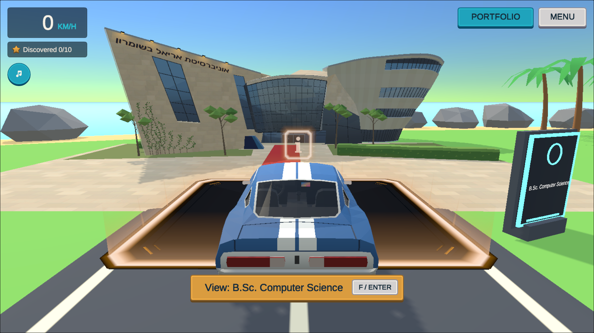
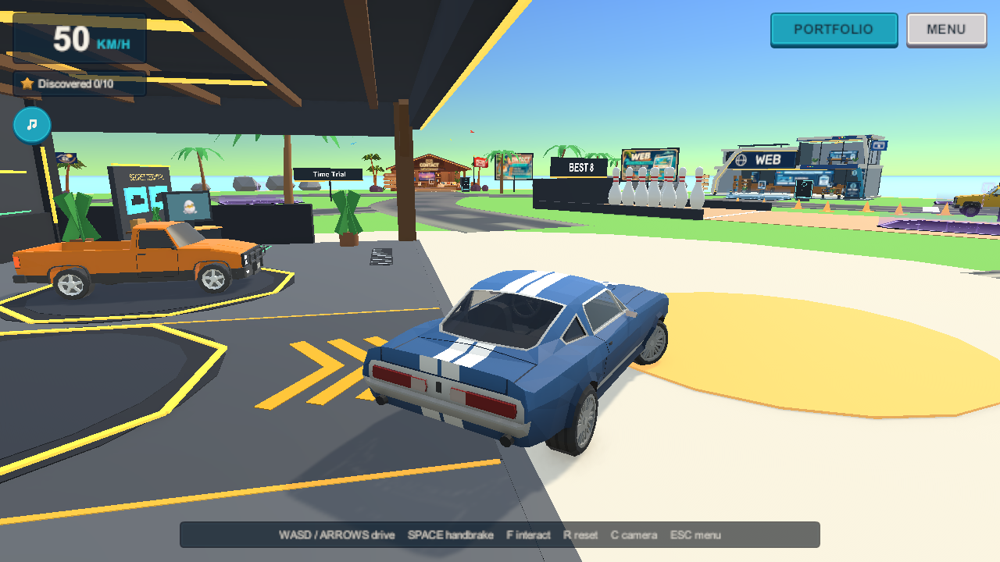
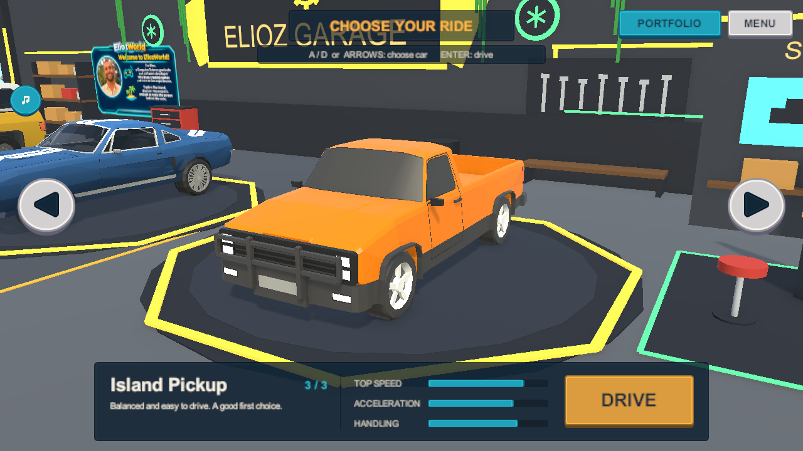
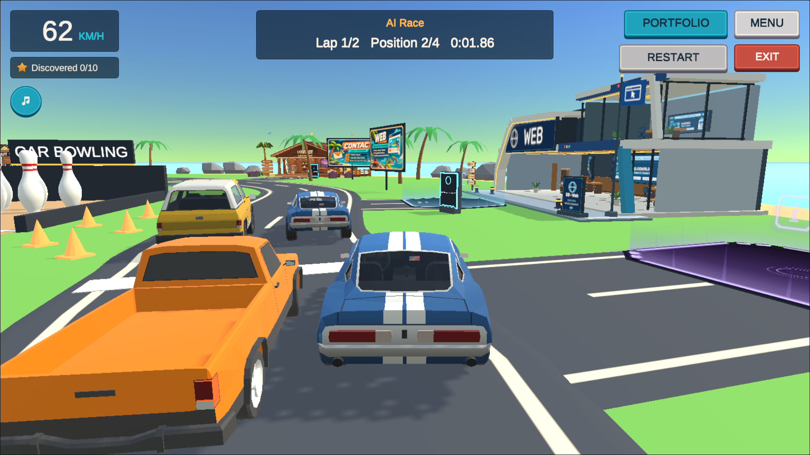
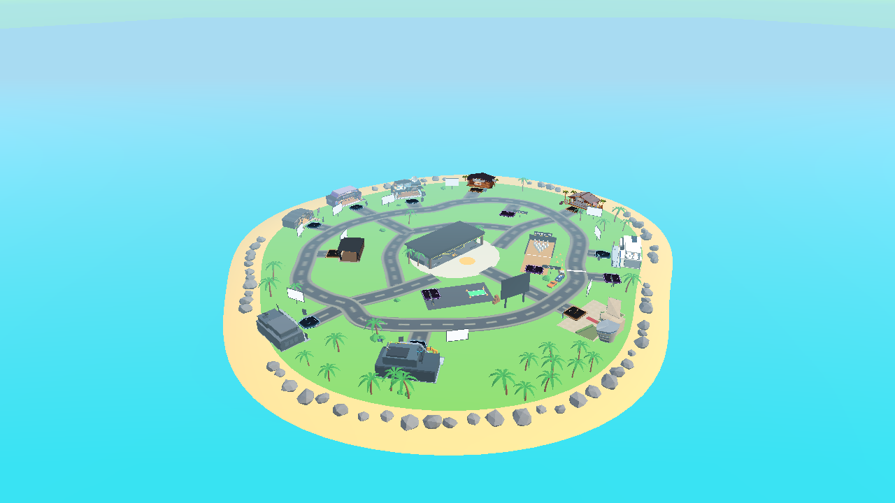
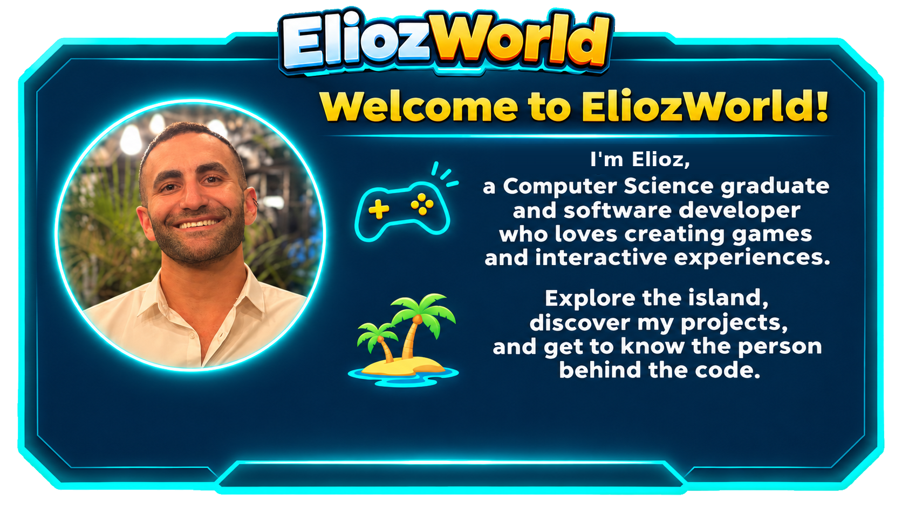
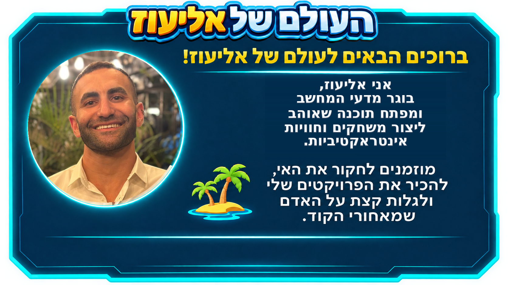

# EliozWorld

An interactive 3D portfolio built with Unity and C#.

Choose a car, explore the island, discover my software projects, and take on driving challenges.

**[Play in English](https://elioz-kolani.vercel.app/game/index.html?lang=en) · [Play in Hebrew](https://elioz-kolani.vercel.app/game/index.html?lang=he)**

[Portfolio](https://elioz-kolani.vercel.app) · [GitHub](https://github.com/Eliozk)

*Ariel University — one of the portfolio stations across the island.*

##  About the Project

The garage is your starting point.

Roads lead to software projects, personal milestones, and driving challenges.

Explore the island at your own pace.

You can also open the portfolio directory to discover my projects without completing any gameplay.

This is a showcase repository. The Unity source, website source, and WebGL build files are maintained separately.

##  Features

- **Three showroom vehicles.** Browse the garage, choose a car, and drive onto the island.
- **Portfolio stations.** Discover projects, education, experience, and contact information.
- **Racing.** Compete against three AI opponents or try a solo time trial.
- **Mini-games.** Take on car bowling and a parking challenge.
- **Cameras and sound.** Switch vehicle cameras, use lights and horns, and hear engine and tyre skid sounds.
- **Desktop and touch input.** Drive with keyboard controls or on-screen touch controls.
- **Two languages.** Play in English or Hebrew in the same game build.

##  A Little Secret... 😉

> There's a hidden terminal in the garage.
>
> Find it, crack the code, and see what surprises are waiting for you.
>
> No spoilers here. Good luck!

##  Gameplay

### Driving

*Leaving the garage and heading out to explore.*

### Garage and Vehicle Selection

*Browse the showroom, compare the cars, and choose a ride.*

### Racing Against AI

*An active four-car race. The HUD tracks laps, position, and elapsed time.*

### Island Overview

*The road network connects the garage, portfolio stations, and driving challenges.*

##  Bilingual Experience

English and Hebrew share one Unity scene and one WebGL build.

The portfolio sets the initial language with `?lang=en` or `?lang=he`.

Same-origin `postMessage` messages can change the language while the game is running.

The Hebrew interface includes right-to-left text handling.

| English | Hebrew |
| :---: | :---: |
|  |  |

##  Technologies

| Part | Technologies |
| --- | --- |
| Game | Unity 6 (`6000.3.20f1`), C#, URP 17.3, Unity Input System, uGUI, WebGL |
| Portfolio website | Next.js, React, TypeScript |

##  Engineering Notes

### Vehicle Simulation

A custom arcade controller uses raycast suspension. One motor writes vehicle state.

Presentation systems, including lights and audio, read that state.

### Input

Keyboard/gamepad and touch sources feed a shared input coordinator.

Driving input can be suppressed during garage transitions, race countdowns, and UI interactions.

### Game Flow

A mini-game director manages one active challenge at a time.

The race and time trial share road samples and lap tracking.

### Browser Integration

The website and Unity communicate through a same-origin bridge.

It exchanges loading progress, readiness, and language messages. It also supports suspend/resume and exit messages.

### Testable Rules

Driving math, scoring, parking checks, and localization logic live in plain C# classes.

EditMode tests cover these rules. PlayMode tests cover scene integration.

##  Controls

**In the garage:** use **A / D** or the **left / right arrows** to browse cars.

Press **Enter** to drive.

| Action | Keyboard |
| --- | --- |
| Accelerate / brake / reverse | W / S or up / down arrows |
| Steer | A / D or left / right arrows |
| Handbrake | Space |
| Interact with a station or start a challenge | F or Enter |
| Change camera | C |
| Horn | H |
| Toggle headlights | L |
| Reset the car | R |
| Open or close a menu | Esc |

**On touch devices:** use the on-screen steering, pedals, handbrake, and interaction controls.

The garage supports swiping and arrow buttons to browse cars.

##  Links

- [Play in English](https://elioz-kolani.vercel.app/game/index.html?lang=en)
- [Play in Hebrew](https://elioz-kolani.vercel.app/game/index.html?lang=he)
- [Portfolio](https://elioz-kolani.vercel.app)
- [GitHub profile](https://github.com/Eliozk)
- [LinkedIn](https://www.linkedin.com/in/elioz-kolani)

##  Credits and Licensing

The game combines project-created work with third-party models, UI, fonts, and audio.

The Welcome artwork was generated specifically for me with ChatGPT’s image generation tool, using my own personal photograph as the reference.

See the [game credits](https://elioz-kolani.vercel.app/en/credits) for creators, sources, and licenses.

This showcase contains documentation and screenshots. It does not distribute the Unity project or third-party asset packs.
